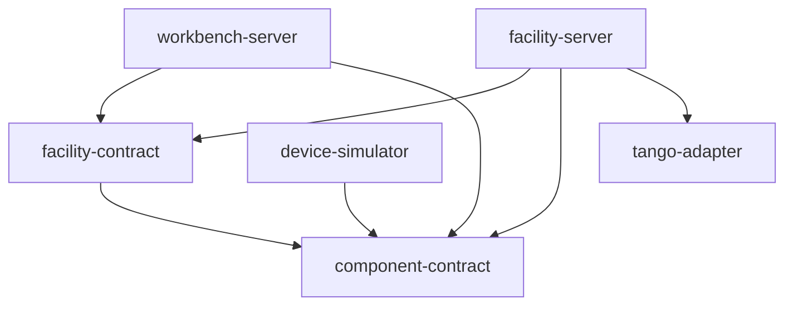
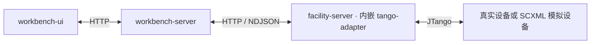

# 模块命名与代码组织

项目分为设施运行系统与实验工作台。模块按职责命名：`*-contract` 提供模型定义和静态校验，`*-server` 是业务后端，`*-adapter` 是进程内设备协议库，`*-simulator` 提供模拟设备，`*-ui` 是浏览器界面。

| 模块 | Java 包或代码入口 | 职责 |
|---|---|---|
| `component-contract` | `cn.cdi8.component.contract` | 单设备 SCXML 元数据、状态/动作/事件引用校验 |
| `facility-contract` | `cn.cdi8.facility.contract` | 设施定义、绑定、投影规则与跨模型校验；`xml` 子包负责 XML/XSD 加载 |
| `facility-server` | `cn.cdi8.facility` | `api` 提供接口和通知；`runtime` 管理观测、事实、监督、准入和持久化；`integration` 连接设备适配器 |
| `workbench-server` | `cn.cdi8.workbench` | `model` 管理模型；`workflow` 执行流程和发次；`workflow.facility` 实现 BPMN 设施扩展；`integration.facility` 调用设施后端 |
| `tango-adapter` | `cn.cdi8.tango` | JTango 连接、命令、快照、事件及补读，不启动独立进程 |
| `device-simulator` | `cn.cdi8.simulator` | `engine` 执行 SCXML；`runtime` 维护设备状态；`tango` 暴露设备协议；`environment` 生成设备配置；进程生命周期由设施侧启动器管理 |
| `workbench-ui` | `src/` | Vue 工作台、模型编辑器和运行视图，构建后打入工作台 JAR |

## 组件与设备命名

组件是设施中的逻辑控制单元，有类型和实例；设备是可以连接、读取快照和下发命令的协议对象。当前仿真将一个组件实例暴露为一个 Tango 设备，一个 JVM 可以承载多个设备。

| 名称 | 含义 | 示例 |
|---|---|---|
| `componentType` | 系统定义中的组件类型 | `seed` |
| `componentInstanceId` | 系统定义中的逻辑组件实例 | `seed-01` |
| `deviceBindingKey` | 设备目录与设施绑定关联的键；不要求与类型同名 | `source-adapter` |
| `deviceId`，设备对象中的 `id`，事件中的 `device_id` | 实际访问的设备编号 | `seed_01` |
| `componentLabel` | 快照中的组件显示名称，不用于绑定或准入 | `光纤种子源组件` |

绑定 XML 使用 `deviceBindingKey` 和 `deviceIdPattern`，经 `instanceSetRef → typeRef` 解析组件类型。运行目标同时携带组件类型、已绑定的组件实例和设备编号；设备目录只提供绑定键，设施后端负责解析业务含义。

`ComponentContract` 定义组件模型契约，`ComponentRuntime` 执行组件行为，`ComponentDevice` 把该行为暴露为 Tango 设备。类名保留各自职责，JSON 字段不再共用含义不明的 `component`。

设施仿真方案中的 `deviceGroups` 按设备绑定键组织各组模型和数量。旧保存方案中的 `facility.components`、`devices[].component`、旧 Tango 配置中的 `component`、绑定 XML 的 `runtimeKey/runtimePattern` 仍可读取；新写出的配置及接口使用明确字段。历史目标、依赖记录和旧设备快照按所在结构解释旧字段，冲突值会被拒绝，已有模型版本和运行证据不会被批量改写。

## 构建依赖

箭头表示 Maven 依赖。两个业务后端之间通过 HTTP 协作。

`tango-adapter` 只产出普通 JAR，集成在 `facility-server` 内。设施侧 `TangoGateway` 直接调用 `TangoAdapter`，把设备观测交给事实与监督运行时。模块不依赖 SCXML，也不负责模拟设备进程。

`facility-server/simulation/SimulatorLauncher` 按需启动独立的设备 JVM；设备 JVM 自行解析 SCXML、生成配置并提供 Tango 服务。设施后端通过真实 Snapshot 验证全部新设备后才切换，失败保留原环境。模型校验使用模拟器的短时 `--validate` 命令，因此后端没有 SCXML 引擎依赖。

## 运行协作

观测沿设备侧向设施后端汇集，命令经过设施准入后下发。工作台的 `FacilityClient`、`FacilityStateClient`、`FacilityDependencyClient` 负责远程访问；设施端 `FacilityDependencyRuntime` 执行实际依赖监测，`FacilitySupervision` 维护系统工作状态义务。

`TangoGateway` 是设施后端的进程内设备网关，JTango 协议实现属于 `tango-adapter`。系统监督仍称为 supervision，但整个设施后端称为 facility。

## 资料与命令

根目录不再单设 `contracts/`。原有接口说明和四份 JSON Schema 放入 [docs/interfaces](../interfaces/README.md)，供阅读和集成参考；它们未被运行时加载。JSON Schema 的既有 `$id` 保持稳定，不代表磁盘路径。参与执行的 Java 模型契约和 XSD 位于两个 `*-contract` 模块，GXLF 模型源文件位于 `examples/`。

| 用途 | 命令 |
|---|---|
| 构建两个后端与 UI | `make backend-package` |
| 独立运行设施后端 | `make facility` |
| 独立运行工作台后端 | `make workbench` |
| 构建并后台启动完整模拟系统 | `make simulation` |
| 查看/停止完整模拟系统 | `make simulation-status` / `make simulation-stop` |
| 已构建后启动设施侧及其模拟设备启动器 | `make facility-start` |
| 已构建后单独重启工作台 | `make workbench-restart` |

统一进程入口为 `java scripts/Services.java start|stop|restart|status [facility|workbench|all]`。默认操作 all；facility 范围包括按需创建的模拟设备子进程。旧的 `make workbench` 完整启动用法已改为 `make simulation`，`make java-workbench-smoke` 改为 `make simulation-test`。

模块迁移不移动用户数据。设施状态仍位于 `data/supervision/`，工作台模型位于 `data/workbench/`，数据库仍使用 `data/control-v2`。接口及配置兼容说明见[设施运行边界](facility-runtime.md)。
