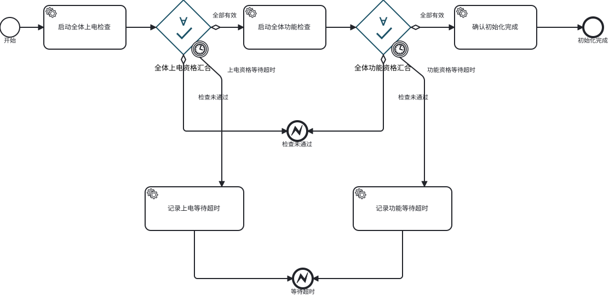

# 资格汇合网关 ∀✓

初始化流程使用两个独立的菱形业务节点：`power_gate`（全体上电资格汇合）和 `function_gate`（全体功能资格汇合）。节点直接表达“等待全体完成、全体当前资格核验、等待期间失效监控”，可以点击查看参与集合、要求资格、核验进度及逐设备命令。



这是项目定义的业务网关。XML 使用标准 `bpmn:receiveTask` 承载 Flowable 的可持久化等待，`gxlf:qualificationGateway` 声明业务语义；浏览器通过自定义 moddle 和渲染器将其绘制成带 `∀✓` 标记的菱形。Flowable 中它仍是等待活动，执行规则由 `QualificationGateway` 实现，不会改变标准并行网关的令牌汇合规则。在未安装本项目渲染扩展的编辑器中会显示为普通等待任务。

## 节点配置

```xml
<bpmn:receiveTask id="power_gate" name="全体上电资格汇合">
  <bpmn:extensionElements>
    <gxlf:qualificationGateway
        targets="allComponents"
        action="power_on_check"
        outer="notReady"
        state="powerOnOk"
        continuationStates="notReady/powerOnOk notReady/checkFailed ready/functionReady"
        timeout="${commandTimeout}" />
  </bpmn:extensionElements>
</bpmn:receiveTask>
```

| 属性 | 语义 |
|---|---|
| `targets` | 流程启动时冻结的组件集合变量；不得为空或重复 |
| `action` | 本轮每个组件执行的检查动作 |
| `outer` / `state` | 本轮成功时要求的外层状态和叶子状态 |
| `continuationStates` | 后续阶段允许的资格演进；上电资格允许升级为功能正常 |
| `timeout` | 正的 ISO-8601 时长或流程变量引用；解析后的值写入 `qualificationTimeout`，供当前网关边界定时器使用 |

功能网关使用 `function_check`、`ready/functionReady`，后续允许状态为 `ready/functionReady`。`continuationStates` 是已取得资格在后续阶段的保持规则，不放宽本轮成功判据。

## 执行规则

1. “启动全体检查”任务读取后继网关配置，持久化本轮设备清单及逐设备稳定命令 ID。Flowable 提交网关等待活动后，协调器才实际发送 Tango 命令。
2. 网关按设备等待本轮命令。`accepted` / `executing` 继续等待；命令关联不匹配、拒绝或失败走“检查未通过”出边。
3. 单个命令成功后，读取当前快照，核验要求资格、无活动命令及最近结果关联，持久化已取得的资格证据。快的组件留在网关内等待其余组件。
4. 等待期间持续检查已取得资格；进入功能检查后，继续保持上电资格监控，同时逐个建立功能资格。当前流程的功能检查命令属于允许的后续动作，不会被误判为外部命令。
5. 全部证据齐全后，重新读取每个设备的当前状态。全部有效才设置网关成功条件并沿成功出边继续；历史命令成功不能替代当前资格。
6. 资格失效通过 `QualificationLost` 消息中断初始化作用域，走图上独立的“已取得资格失效”路径。失效原因锁存，不能因后续恢复覆盖；超时通过各网关的边界定时器进入带阶段名称的失败路径。
7. 初始化完成前再次核验全体资格。网关证据、结果、状态及命令关联保存在 Flowable 变量与历史中；协调器重启后继续等待和核验，重试发送仍使用原命令 ID。

两个网关之间的普通成功顺序流连接的是业务资格，而不是四条固定的组件分支。因此组件数量由参与集合决定，不需要按设备数量增加连线。

## 事件顺序和边界

组件快照增加 `state_revision`，取持久化事件序号，不修改既有数据库结构。总控保留每份成功证据的版本：早于或等于该证据的旧事件不会撤销更新的资格；其后的失效事件即使随后恢复，也会被锁存。事件缓冲溢出按无法确认持续资格处理。

事件订阅负责观察期间变化，阶段汇合负责当前状态补读。没有设备版本的外部实现会保守处理收到的事件；跨设备快照读取不提供物理原子性，未送达的历史变化还需要真实设备的资格版本、事件重放或失效锁存契约补足。

停止和失败当前只终止编排，设备已经受理的动作由组件端处置；本次实现没有新增设备取消接口，也没有自动恢复混合资格的初始化流程。参与集合仍沿用运行版的 `allComponents`，完整拓扑与预约策略另见前期准备说明。

实现位置：

- [初始化 BPMN](../../src/main/resources/processes/component_initialization.bpmn20.xml)
- [网关执行逻辑](../../src/main/java/cn/cdi8/control/QualificationGateway.java)
- [网关渲染和模型扩展](../../src/main/resources/static/qualification-gateway.js)
