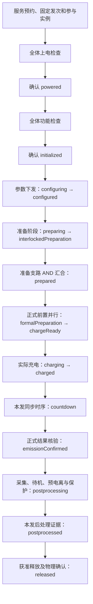

# 实验主干与系统状态对应表

> 历史说明：本表记录上一阶段 BPMN 主干与综合系统状态的对应关系。综合状态模型已经删除；当前设施结构见[系统定义模型设计](系统定义模型设计.md)，本表中的运行阶段待迁移到发次运行模型。

本表以[集中管控系统控制流程业务说明](集中管控系统控制流程业务说明.md)为业务依据，将“必须执行的操作”与“允许继续的事实”分开定义。不是从现有演示代码反推实验规程。

当前已落地的技术验证入口是 `gxlf_initialization_parameter_dispatch`。它使用十四类设备初始化和参数下发的连续流程，验证同一份系统状态记录能否被操作流程推进；其中参数下发阶段暂把十二类可参数化设备的成功结果与当前状态作为 `configured` 的临时判据，真空和控制环境只作为当前状态观测对象。这个判据用于验证架构路径，不能直接作为生产放行规则。

对应模型：

- [实验主干 BPMN](../../../../examples/gxlf/design/gxlf_experiment_backbone.bpmn20.xml)：完整业务设计，`isExecutable="false"`，包含阶段内关键并行、汇合、观测等待及异常出口；放在 `design/`，不参与服务的自动打包部署。
- [`gxlf-facility.system-definition.xml`](../../../../examples/gxlf/system/gxlf-facility.system-definition.xml)：当前设施结构定义。本文原先引用的 17 个运行阶段和状态转换属于已删除的综合状态模型，待发次运行模型建立后重新映射。
- [十四类初始化执行流程](../../../../examples/gxlf/bpmn/gxlf_system_initialization.bpmn20.xml)：已经接入执行的初始化段。旧四组件全周期仍是简化演示，不作为完整主干的实现。

**本次完成的是成对的业务建模和可追溯关系，不是十四类设备全周期执行上线。** 图上的一般任务表达操作意图，接收任务表达证据等待，均未伪装为已经实现的设备适配。不得仅修改 `isExecutable` 就运行。

## 1. 共同规则与职责

流程决定操作顺序和申请转换的时机；系统模型核验能否进入下一阶段，并持续检查当前阶段。设备事件可以唤醒核验、使流程中断，但条件满足不会自动跳过必做操作或人工授权。

| 内容 | 权威定义位置 |
|---|---|
| 必做操作、次数、先后及并行汇合 | BPMN；例如两次精闭环、采集后待机、主发后再预电离 |
| 整体阶段、设备叶状态接受范围 | `.system.xml` 的 `state/fact/require/use` |
| 进入条件与持续条件 | `.system.xml` 的 `scope="entry"` 与默认 `invariant` |
| 单设备可接受动作与自身保护 | 设备 SCXML 与动作契约 |
| 发次结果、历史、授权、同步时间证据 | 需要独立证据协议；当前 DSL 只有设备状态谓词，不能冒充已支持 |
| 尚未完成的业务决定或接口 | 本表缺口清单、既有异常评审清单，以及系统模型的 `blocked` |

所有阶段均适用 §3：运行前预约分系统服务、确认本发参与集合及权限；执行期间监测接口健康并设响应期限。业务表中的预计执行时长不自动等于响应超时。阶段时长不转换成可证明同步精度的 BPMN 定时器。

系统阶段是设备配置的允许集合，不是某条命令结果的别名。当前设备处于待机，不能证明本发先前已采集；当前状态正常，也不能证明来源和事件链连续。系统模型不能靠读取一个旧的成功标志放行新发次。

## 2. 主干与系统状态总览

图中箭头表达业务顺序，不表示当前都可执行。系统模型的未决转换仍明确阻断，当前实际操作链只接通到 `initialized`。

## 3. 阶段—操作—条件—证据—异常对应

以下“入口”不仅指源码中的 `sys:requires`，还包括完整实现前必须补齐的业务约束；“持续条件”使用现有 fact 名称引用，不在 BPMN 复制设备谓词。E0–E8 的证据缺口见第 5 节。

| 阶段 / 业务依据 | 必须执行的操作（BPMN 节点） | 入口条件 | 持续条件 | 完成证据与下一状态 | 异常去向 / 当前缺口 |
|---|---|---|---|---|---|
| 运行准备 §1、§3 | `reserve_services`：预约服务，固定本发与实例/束线选择 | 任务已加载，有操作意图及权限 | 预约所有权、服务健康 | 本发参与集合与资源预约凭据；进入 `uninitialized` | 未获权限不启动；E0，未接入 |
| 上电检查 §3.1 | `initialize/power_checks`：全体并行检查，非物理上电 | `uninitialized`，设备本地准入 | `initialChecks`，事件/连接证据可信 | 全体命令成功 + `powerChecked`；报告 `powered` | 任一失败/超时/未知不进入功能检查 |
| 功能检查 §3.1 | `initialize/function_checks`：全体上电屏障之后并行功能检查 | `powered`，每次发送前再核验 | `powerMaintained`，允许正常进入功能完成状态 | 全体本次结果 + `functionChecked`；报告 `initialized` | 中断，保留其他已受理命令未决项 |
| 参数下发 §6.1 | `begin_configuration → configure`：按发次、阶段、束线下发并核验接收/生效 | `initialized`，配方加载且服务权限有效 | `configurationInProgress` | 技术验证切片记录十二类可参数化设备的结果，并核验当前配置状态后报告 `configured` | 已实现技术验证路径；生产仍需 E1 的发次/版本关联和真空参数证据 |
| 建立安全联锁 §3、§6.8–6.10 | `prepare`：清场、屏蔽门关闭/锁定、人员与真空证据核验 | `configured → preparing`；禁止提前执行受保护动作 | `configuredDevices`；预约、服务持续有效 | 技术验证使用控制环境清场/锁门和真空当前 `functionReady` 假设；报告 `interlockedPreparation` | 已实现技术验证路径；生产仍需 E2 的独立门锁、人员和钛泵真空证据 |
| 发射准备 §5.1、§6.2–6.22 | 出光、双通道重频、唤醒/粗细闭环、靶预定位/模拟定位、准直/引导、诊断、泵浦准备及引导后三路 | 受保护任务要求联锁有效；各支路依赖见第 4 节 | `configuredDevices`、`knownInterlock`；本发供光、同步和接口条件在依赖期间保持 | AND 汇合 + `selectedLightStable`、`preparationHardware`，报告 `prepared`；汇合不发命令 | 已实现技术验证路径；正式生产仍需 E2/E3 证据和双通道时序 |
| 正式发射前置 §5.2、§6.23–6.32 | `formal_prepare`：诊断设置、晶体位姿、充电准备/警示、第二次精闭环→预放单次→清零、测量单次→打靶准备、开关充电 | `prepared → formalPreparation` | 参数、联锁、所选光源持续有效 | 六路 AND + `formalHardware`，报告 `chargeReady` | E3/E4 阻断；第二次精闭环不能省略为已有结果 |
| 泵浦充电 §6.33 | 先 `begin_charging`，再 `charge_request`，等待 `charge_completed` | `chargeReady`；先进入允许过渡的 `charging` | `chargingHardware`、`chargeSupportMaintained`、参数/联锁/光源 | 泵浦本机实际 `chargeComplete`；报告 `charged`；停止音乐、保持警灯 | 请求成功仅说明开始充电；异常涉及停充/泄放，策略待 D2 评审 |
| 同步触发 §6.34–6.36 | `synchronized_emission`：协调时序，确认本发 T0、T+3 泵浦/开关准备、T+5 同步实际输出 | `charged`；时序接口和本发时钟核验后进入 `countdown` | `countdownHardware`、参数/联锁/光源及有效时序 | 同一发次及时基的三个实际结果 | E5 阻断；没有用 PT3S/PT5S 定时器代替同步协议 |
| 发射结果 §6.37 | `report_emitted`：按确认后的判据核验结果 | 时序链结束，但不能仅凭令牌到达判成功 | 发射阶段事实与证据完整性 | 同步/泵浦/开关的本发权威结果；报告 `emissionConfirmed` | E6 阻断；结果未知不能推断“未发射”，紧急指令依据 D1/D6 |
| 后处理 §5.3、§6.38–6.57 | `postprocess`：并行采集、待机、诊断、靶分析/收靶、泵浦预电离、开关波形/待机、吹扫启动并移交 | `emissionConfirmed → postprocessing` | `postprocessingDevices`、联锁；保护吹扫独立保持 | 本发采集→待机等历史、预电离子周期结果、保护监护交接；报告 `postprocessed` | E7 阻断；不能用终态叶状态倒推全部历史 |
| 正常释放 §3、§6.58 | `release`：先核验获准的释放规则，再解锁/开门及物理确认、警示解除和结束播报 | `postprocessed` + 获准的开门/释放规则 | 后处理结果、可观测设备、独立保护任务 | 门锁与门扇位置、警示/播报结果、保护归属；报告 `released` | E8 阻断；正常开门不等同联锁事故紧急解锁 |

设备故障、安全联锁、状态条件失效、证据未知分别保留异常类别，不能统一描述成“设备故障”。业务阶段保留在异常发生的位置，完整性另记 `violated/unknown`。

## 4. 必须保留的流程结构

### 4.1 初始化屏障

任何设备开始功能检查之前，必须全部参与实例上电检查完成并经过系统状态核验。先完成的设备不自行跨越这个屏障。BPMN 主干内联两个多实例任务，不调用一个会另行创建系统状态记录的初始化子流程；未来执行化应让主干拥有一份系统状态记录。

### 4.2 准备阶段的依赖

- 预放重频 → 唤醒；唤醒与所选出光 AND → 粗闭环 → 第一次精闭环。
- 测量重频 → 测量靶瞄准备；它与实验靶预定位 AND → 模拟靶定位。
- 模拟靶定位分出诊断准备和光束引导依赖。
- 出光与唤醒 AND，加上重频、联锁、吹扫停止及接口条件 → 光路准直。
- 准直与模拟靶定位 AND → 光束引导 → 三路：靶复位再入打靶、测量打靶运动准备、打靶运动准备。后二者分开表示，未因相似名称合并。
- 上述结果与泵浦准备、诊断准备、第一次精闭环全体 AND 汇合，再核验 `prepared`。该汇合不执行控制操作。

**顺序细化待评审**：§4 描述清场和其他准备支路并行展开，但 §6.2–§6.6 等 card 又要求安全联锁正常。主干当前采用保守细化：先建立联锁，再启动这些受保护支路。它没有声称继承图纸 31.5 分钟工期。若希望并行，须先明确哪些操作允许在联锁建立前执行，并在各任务入口设置独立等待；不能以“并行网关已分支”代替联锁许可。

### 4.3 正式前置与时序

六条前置支路必须全体汇合；警灯/音乐位于发射充电准备之后，并作为充电前置链路的一部分。充电动作请求与实际完成是两个节点。`charging` 必须在请求之前建立，否则持续条件还停在 `chargeReady` 的精确叶状态，可能将正常充电误判为失效。

同步段明确区分 T0 受理、T+3 泵浦准备、T+3 开关准备及 T+5 实际输出。图中的并行网关只汇集三个结果，不负责实现精确时序；由同步/设备协调协议预先安排，不能等普通工作流调度到了第三秒才发送准备命令。现有 `countdownStarted` 作为同步阶段的入口申请，尚不能证明真实 T0 已发生。

### 4.4 后处理、预电离和吹扫

主发采集与预电离后采集分开，泵浦链路按数据采集→待机→预电离准备→充电及实际完成→同步触发证据→再次采集→待机建模，关联本发和子周期编号。预电离不将主系统状态重新退回正式发射的 `charging/countdown`。

吹扫分支只在启动后确认 `purgeActive` 并移交持续监护，再参加结果汇集；不等待 40 分钟自然完成，也不把汇合当成保护完成。业务规定的“结束前 15 分钟可进入下一发准备”仍需跨发资源和持续任务模型，本图未自动创建下一发。

后处理 AND 汇集只表示结果收集，不是开门授权。当前采用保守的全支路汇集设计，开门前另设 `release_authorization` 等待；选择“仅等最后泵浦待机”必须经规则确认后修改，不能两种解释同时作为可执行路径。

## 5. 证据缺口与禁止放行的转换

| 编号 | 缺少的业务事实 / 决策 | 系统模型转换 / 主干位置 | 当前表达 |
|---|---|---|---|
| E0 | 服务预约、发次/阶段/束线关联和真实参与拓扑 | `reserve_services`，全流程 | 业务任务；未增加可伪造的系统状态谓词，主干不可执行 |
| E1 | 真空本发参数确认，以及各设备参数版本/发次关联 | `configurationVerified` / `report_configured` | 技术验证暂以当前状态和十二类命令终态放行；生产必须补齐发次/版本关联后再收紧转换 |
| E2 | 独立门锁、门位置、人员计数、多程钛泵真空；风淋门范围与准备时序 | `safetyVerified` / `report_interlocked` | 技术验证使用模拟控制环境和真空状态假设；生产必须补齐独立接口 |
| E3 | 预放/测量两个重频和两个单次通道各自证据 | `preparationVerified`、`chargePrerequisitesVerified` | 技术验证只跑一条预放重频链；正式生产仍需双通道证据 |
| E4 | 警灯、音乐开启/关闭的独立观测 | `chargePrerequisitesVerified`、正常释放 | 保留 `blocked`，操作请求不等于物理反馈 |
| E5 | 本发统一时钟、T0受理、T+3/T+5时间戳和实际输出 | `countdownStarted` / `enter_countdown` | 保留 `blocked`；接收任务是未接入的证据等待 |
| E6 | 正式发射成功/部分成功/未知的权威组合判据 | `emissionVerified` / `report_emitted` | 保留 `blocked`；不以准备就绪代替实际发射 |
| E7 | 本发采集/待机历史、预电离结果、吹扫持续监护与交接 | `postprocessingVerified` / `report_postprocessed` | 保留 `blocked`；现有 `postprocessingObserved` 非历史证明 |
| E8 | 正常开门汇合策略、解锁/开门/人员进入的区别、警示解除与结束播报 | `releaseVerified` / `report_released` | 保留 `blocked`，与事故解锁分离 |

证据协议接入时至少需要：发次、阶段/子周期、设备实例、命令或事件关联、结果、观测时间/来源及适用范围。哪些结果是一次性的、哪些事实必须持续有效，要单独定义。当前 `.system.xml` **不支持上述任意历史/时间条件的通用求值**；本次没有引入看似可执行、实际无人解释的新 XML 标签。

## 6. 放行点与状态转换一一对应

系统模型的 `operation` 字段仅记录关联，不执行字符串。下列节点同时携带 `sys:report transition="…"` 设计引用和相同的 `systemStates.report` 表达式；执行化前仍需绑定操作、事件相关及期限。

| BPMN 报告节点 | 系统转换 | 来源 → 目标 |
|---|---|---|
| `report_powered` | `powerChecksVerified` | `uninitialized → powered` |
| `report_initialized` | `functionChecksVerified` | `powered → initialized` |
| `begin_configuration` | `beginConfiguration` | `initialized → configuring` |
| `report_configured` | `configurationVerified` | `configuring → configured` |
| `begin_preparation` | `beginPreparation` | `configured → preparing` |
| `report_interlocked` | `safetyVerified` | `preparing → interlockedPreparation` |
| `report_prepared` | `preparationVerified` | `interlockedPreparation → prepared` |
| `begin_formal` | `beginFormalPreparation` | `prepared → formalPreparation` |
| `report_charge_ready` | `chargePrerequisitesVerified` | `formalPreparation → chargeReady` |
| `begin_charging` | `beginCharging` | `chargeReady → charging` |
| `report_charged` | `chargingVerified` | `charging → charged` |
| `enter_countdown` | `countdownStarted` | `charged → countdown` |
| `report_emitted` | `emissionVerified` | `countdown → emissionConfirmed` |
| `begin_postprocessing` | `beginPostprocessing` | `emissionConfirmed → postprocessing` |
| `report_postprocessed` | `postprocessingVerified` | `postprocessing → postprocessed` |
| `report_released` | `releaseVerified` | `postprocessed → released` |

从初始状态沿未阻断转换仍最多到达 `configuring`；本次只关联设计节点，没有解除任何已有证据阻断。

## 7. 异常出口与执行化边界

主干的动作错误、系统条件失效/未知、人工停止和整体响应超时都中断 `normal`，进入 `record_incident → response_plan → response_evidence → failed_end`。系统失效使用设计消息 `SystemConditionLost` 表达意图；现有执行器使用 `StopWorkflow`，本次没有新增消息适配。

这个异常路径表示需要按异常类别、阶段和设备选择处置，而不是所有失败都下发相同动作。具体规则见[异常处置规则评审清单](异常处置规则评审清单.md)D1–D9。安全联锁的全体终止、紧急解锁及警报要求仍在规程中；图没有伪造这些动作已经实现。`response_evidence` 未确认前不能称为物理安全，保护吹扫不因主干取消而停止。故障后的旧发次不自动恢复。

四个交付层次应分开检查：

1. 业务对应：每个阶段和关键依赖可追溯到业务说明；冲突/缺口显式列出。
2. 模型一致：报告点、系统转换、源/目标阶段、图形引用一致；所有原阻断保留。
3. 执行接入：设备动作、事件相关、本发证据、期限、异常处置逐段实现；当前仅初始化具备既有执行流程。
4. 实际验证：再做逐段 Tango 集成及现场反馈验证，不以模型能画出来代替执行验收。

可以在工作台导入 `design/` 内的 BPMN 查看和编辑，系统模型作为单独文件查看。设计模型不会自动出现在运行列表；不得把通用 `task` 或无消息相关实现的 `receiveTask` 当作已经完成设备控制接入。
# 历史说明

> 本表记录上一阶段 BPMN 主干与综合系统状态的对应关系。综合状态模型已经删除；当前设施结构见[系统定义模型设计](系统定义模型设计.md)，本表中的运行阶段待迁移到发次运行模型。
