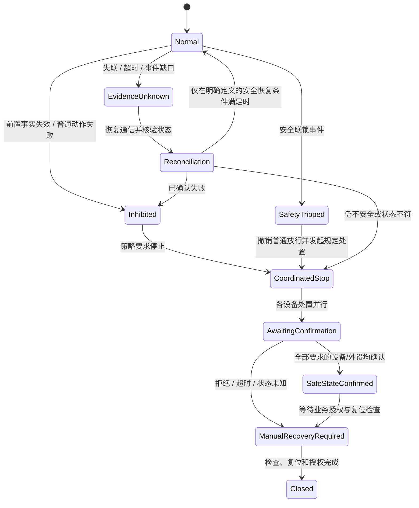

# GXLF 异常场景与系统状态建模

> 历史说明：本文描述上一阶段的综合运行状态和异常锁存实现。当前设施系统定义不再包含这些运行阶段；异常事实应分别进入设施状态投影和发次运行模型。

本文依据[集中管控系统控制流程业务说明](集中管控系统控制流程业务说明.md)，梳理正常业务阶段中断后，实验系统应如何表示异常、协调处置和恢复。业务说明中已明确的要求与建模建议、待确认事项分开记录；本文不为物理设备补造应急动作。

现有[系统状态模型设计](系统状态模型设计.md)定义正常生命周期阶段，并在运行时记录 `valid / violated / unknown`。十四类设备 SCXML 已各自包含故障、通信异常、超时、本发终止和复位路径。系统层现在通过 `<anomaly>` 声明异常类别，并把观测到的联锁、设备故障、阶段条件失效和证据未知写入本次运行的 `incidents`；这些记录会锁存并阻断正常编排。逐设备终止请求、处置结果汇合、人工授权关闭等完整事故处置流程仍未实现。

上一阶段综合模型中的异常类别包括 `deviceFault`、`safetyInterlock`、`stateConditionLost`、`evidenceUnknown` 和 `commandOutcomeUnknown`。这些类别不属于当前设施结构定义；后续应分别在设施状态投影和发次运行模型中重新定义。运行时如何从 Tango 事件及快照形成异常证据，待新运行模型确定后再实现。

设备命令在发送后无法确认结果时，运行时按命令 ID 创建或更新 `commandOutcomeUnknown` 事故记录，并阻止新动作下发；只继续查询原命令，不因查询失败而重发。原命令最终得到终态后，记录核对结果为 `reconciled`。这只表示命令结果已经查明，不会清除本次运行的系统完整性锁存，也不会自动恢复普通流程。

## 建模原则

### 不用单一 `failed` 代替异常状态

异常发生时保留实验生命周期阶段及当前发次。例如“主发倒计时期间联锁触发”仍需保留 `countdown` 作为发生上下文，同时进入锁存的安全处置流程。安全处置失败、设备故障和控制系统失去观测能力具有不同含义，不能压成一个状态。

### 分开表示三个维度

| 维度 | 建议表达 | 例子 |
|---|---|---|
| 实验阶段 | 正常生命周期当前所处阶段 | `preparing`、`charging`、`countdown`、`postprocessing` |
| 系统控制完整性 | 阶段条件是否仍可信 | `valid`、`violated`、`unknown`；其中安全联锁触发需单独锁存，不能只作为普通谓词失效 |
| 事故处置进度 | 系统已发现什么、处置到哪一步 | `detected`、`inhibited`、`stopRequested`、`awaitingConfirmation`、`safeStateConfirmed`、`manualRecoveryRequired`、`closed` |

还要按设备/流程分支保存命令进度：`notSent`、`accepted`、`running`、`succeeded`、`rejected`、`failed`、`unknown`。整体事故状态是这些参与者结果的投影，不覆盖或丢弃单台设备状态。

一次事故记录至少应关联：事故编号、类型、严重度、发生阶段和时间、触发设备/接口、发次/任务/节点、影响范围、相关命令编号、设备确认结果、处置规则引用和人工确认记录。应保存并发发生的多条原因，不能只保留最后一个错误。

### 区分失败、拒绝与未知

- 设备明确报告动作失败、故障锁定，属于已知失败；记录设备和最终物理状态。
- 动作在请求阶段被拒绝，表示动作未被接受，不等同于设备故障；保留拒绝原因，当前阶段不得推进。
- 命令超时、服务失联、事件缺口或证据过期，表示动作/状态未知。不得假定设备已停止，也不得自动重发有物理副作用的命令；先通过独立观测和命令关联进行核对。
- 安全联锁事件是独立的高优先级事故，即使同时出现普通设备失败，也不能被普通流程错误覆盖。

### 处置完成必须有设备证据

工作流取消、终止指令发送成功、设备受理终止、设备报告动作停止、设备达到经确认的安全状态，是不同事件。系统只有在所需设备逐一确认后，才能报告相应的处置汇合完成；无法确认的设备保持 `unknown` 并转人工处置。流程结束不推定设备已停止，恢复设备也不清除本次事故锁存。

## 异常场景矩阵

| 场景与触发 | 系统状态表达及立即约束 | 处置汇合与后续门槛 | 依据/待确认 |
|---|---|---|---|
| 初始化上电检查或功能检查失败 | 保留 `uninitialized` 或 `powered`；本阶段 AND 汇合失败，不进入下一阶段。标记失败设备、通过设备和未决设备。 | 失败/超时/未知均不具备本发参数下发资格。设备诊断或复位可另起维护流程，不能把检查失败改写为成功。 | 初始化规则已明确：任一失败、超时、未知均不放行。 |
| 任一流程节点拒绝、失败或无权限 | 保留当前实验阶段，记录流程节点、设备实例和返回结果；停止依赖该结果的后续活动，不将其他成功分支改写为失败。 | 具体是否只取消当前支路，还是整个普通实验进入协调终止，业务说明未统一规定；须明确每类节点的失败策略。 | 节点返回码定义了失败/无权限；一般失败的全局收敛策略待明确。 |
| 并行、多实例中部分设备完成，部分设备失败 | 表示为“局部完成 + 至少一个失败/未知”，整组 AND 不成立。不可自动把故障实例从本发参与集合删除，也不可回滚已经发生的物理动作。 | 初始化明确要求全体通过。其他 10/60 台设备链路的允许部分放行、按束线隔离或整组终止策略需逐阶段确认。 | `发射准备全部完成` 是 AND 汇合；局部降级继续没有授权规则。 |
| 命令超时、接口/设备失联、事件证据中断 | 系统控制完整性置 `unknown`，记录最后可信快照、命令和观测缺口；禁止依赖未知事实的阶段转换及危险新动作。 | 重新连接后先核对设备实例、命令关联、修订和物理状态；不能证明状态时进入人工处置。停止请求没有回执时仍是未确认。 | 每节点需监控服务并配置超时；超时判节点失败已明确。如何判定动作是否仍在执行、何时可重试待接口契约定义。 |
| 安全联锁进入条件不成立或未知 | 不允许进入 `interlockedPreparation` 及其后阶段；门锁、人员计数、真空/钛泵等分别显示缺项或未知，不能以一个演示许可代替。 | 所有必需安全证据达到有效、同一发次且在有效期内后，才可报告联锁成立。 | 联锁条件已列出；风淋门是否必需待确认；多程钛泵真空的权威接口待接入。 |
| 流程运行中触发安全联锁 | 抢占普通业务编排，锁存 `safetyInterlockTripped`；保留触发时的生命周期阶段和全量原因，撤销后续正常放行。 | 按原文向所有流程中分系统发送流程终止请求，并分别跟踪发送、受理、停止确认；屏蔽门解锁和警灯警报也需各自确认。任何未响应设备使处置保持未完成/未知。 | 触发后终止各分系统、解除屏蔽门锁定、启动警灯警报已明确；物理停止次序、部分设备无法响应时的升级策略和确认超时待定义。 |
| 安全联锁解除/现场释放 | 安全处置锁存不能因触发条件消失或门已解锁自动清除。区分“已解锁”“门已打开”“人员可进入”和“本次实验安全收尾完成”。 | 警报解除、结束播报、门控状态、人员计数和设备安全状态全部按确认规则核验；必要时要求授权人员确认，再关闭事故记录。 | 解除条件写有门解除锁闭、警报解除和结束播报；门开启汇合条件、人员计数使用方式及谁有权宣布释放需确认。 |
| 充电准备/警灯或警示音乐失败 | 仍处在正式准备阶段；不得把警示动作受理等同于警灯亮/音乐播放的实际状态，也不得进入充电。若已进入高能状态后失去警示证据，按安全事件评估。 | 需要独立的警灯、音乐命令与状态反馈；确认不可用时的充电禁止/中止策略。 | 业务前置要求警灯和音响系统正常，充电前开警示；组件独立反馈和失败后的策略未定义。 |
| 主发或预电离充电期间异常 | 锁存充电子阶段和泵浦当前状态；不得以 BPMN 流程停止推断已停充。区分尚在充电、充电完成和状态未知。 | 业务说明指定“紧急停充”，必须等待泵浦返回并核验结果；失败、超时或未知转人工处置，不自动进入普通准备。 | 紧急停充及反馈已明确；停止后目标物理状态、失败后的后备措施和解除锁存条件待泵浦接口/安全策略确认。 |
| 充电完成后未能触发 | 单独表示“已充电、尚未确认触发”，不得归入普通 `charged` 后继续或直接结束。主发与预电离都应有发次/阶段标识。 | 业务说明指定泵浦紧急泄放并反馈结果；泄放完成确认后才能进入经定义的安全收尾状态。 | 紧急泄放及结果反馈已明确；什么设备状态/测量值构成泄放完成、结果不明如何处置待定义。 |
| T0/T+3/T+5 时序异常或同步未触发 | 锁存当前倒计时、已完成的泵浦/开关准备、同步输出是否确认；不得将“倒计时已开始”当成正式触发。 | 业务文字指定按钮下发 `紧急触发`，由同步完成触发；必须按其实际含义单独建模和授权，获得同步及相关设备反馈后才决定后续阶段。 | 这是关键未决安全语义：名称看似紧急处置，但效果是触发。需确认何种异常下必须触发、何种条件禁止触发、超时后是否仍允许触发及与紧急停车的区别。 |
| 正式发射结果缺失或设备结果相互矛盾 | 进入 `emissionOutcomeUnknown`，而非假定发射成功或失败；不进入以“已正式发射”为前提的普通后处理结束判定。 | 先按权威证据源核对同步输出、泵浦实际触发及开关实际放电；决定数据采集、设备收尾和事故路径。 | 文档尚未决定以同步总体成功为准，还是泵浦结果也是独立硬判据；开关放电结果的完成口径也需关联。 |
| 发射后的采集、待机、预电离、收靶或开关后处理失败 | 每条后处理支路独立保留状态；总体保持 `postprocessing`，失败支路阻止其要求的 AND 汇合。标记是否已实际发射，不能退回“未发射”。 | 按动作定义允许的安全重试、人工处置或受控结束；不能把流程失败当作所有设备已待机。门控策略必须按确认后的释放条件判断。 | 后处理有多条并行链路；整体门开启汇合规则待确认。单支路失败后的门控策略未定义。 |
| 片放吹扫失败、超时或流程停止 | 吹扫作为独立持续保护任务保留 `purgeActive / purgeUnknown / purgeComplete`；流程终止不得隐式清除吹扫。 | 只有设备确认吹扫完成才可报告保护任务完成；通信未知时不能启动依赖“吹扫已停”的准直条件。跨发次重叠需要同一系统任务协调。 | 40 分钟吹扫、结束前 15 分钟可进入下一发准备已写明；停止/失败时的物理后备处置、跨发次归属和资源预约待实现。 |
| 操作员手动停止 | 区分“停止实验编排”与“设备已停止”。保留所有活动命令及当时相位，不因 Flowable 结束自动释放设备服务预约。 | 对普通人工停止是否必须全设备终止、各高能阶段采取何种处置、如何逐台确认，应按相位和设备策略运行。所有设备安全状态核验后才允许人工结束事故记录。 | 全局规则明确安全联锁要终止所有分系统；普通停止的设备动作策略及设备取消接口尚未统一。 |
| 故障恢复/再次运行 | 故障设备恢复到 `resetReady` 不等于系统或本发恢复。保持故障事故记录和原失败阶段，不继续旧命令或旧发次。 | 依次完成设备内部安全复位、功能检查、重新参数核验和安全条件复验；由操作者显式开启新运行。保护任务仍活动时不得假定可复用相关设备。 | 设备模型建模说明已要求故障锁存、复位后重新功能检查/参数校验、旧发次不得恢复；系统层新发次和授权关系待接入。 |

## 建议的系统级处置状态机

业务阶段和事故处置并行存在，不把每个正常阶段复制成一份故障状态：

此图是建模结构建议，不是已获批准的物理操作顺序。尤其 `EvidenceUnknown → Normal` 必须经过显式证据核对，不能仅因 Tango 重连自动恢复。安全联锁锁存是否可由系统自行清除，当前不假定。

系统级事故处置流程由 BPMN 承担命令编排、并行下发、超时及逐设备收敛；设备 SCXML 负责本机故障锁存和本机可验证的安全处理；系统声明负责触发、抑制正常阶段、要求的证据及处置结束条件。系统不能从 `abort` 请求推断本机物理安全。

## 需要业务/接口方确认的决策

以下问题已整理为带优先级、待决事项、所需反馈和未决期间行为的[异常处置规则评审清单](异常处置规则评审清单.md)，供业务、安全和设备接口评审。

1. `紧急停车` 在倒计时中为何要求 `紧急触发`？它是否确实会使激光/泵浦/开关发生物理触发？紧急触发的授权、截止时刻、禁止条件与失败后路径分别是什么？
2. 紧急停充和紧急泄放的终态各是什么？泵浦必须回到哪个可观测状态/测量范围，哪些独立证据确认该状态？若命令被拒、超时或反馈未知，现场规程是什么？
3. 联锁触发时“向所有分系统下发流程终止”与设备本机 `abort_reset` 如何衔接？高能设备、正在运动的靶瞄/测量、吹扫等有何不同停止或继续保护规则？
4. 终止确认是按设备服务、按束线实例还是按本发参与集合？部分设备不响应时谁接管、如何升级告警、资源是否一直锁定？
5. 屏蔽门解除锁定、发出开门命令、门实际打开、人员允许进入分别由哪个接口确认？人员计数归零是在开门前还是其他时点要求？风淋门是否为硬联锁？
6. 正式发射成功/失败/结果未知的权威判据是什么？泵浦触发、开关放电、同步输出如何组合，冲突时如何收尾和采集数据？
7. 后处理单支路失败时，哪些支路必须阻止开门/结束？预电离失败与主发后处理失败分别允许什么安全收尾？吹扫跨发次如何预约和监督？
8. 普通动作失败是否一律终止整次流程，还是仅终止关联束线/分组？任何部分降级继续都需要定义允许的设备清单、物理影响和重新计算的系统前置条件。
9. 异常自动解除、操作员确认、工程师维护复位和新发次启动各需要哪些角色与审计证据？设备回到 `resetReady` 后仍需要哪些跨设备复验？

## 实施边界与下一步

当前可据业务文档明确实施的是：初始化全体屏障；阶段前置事实未知/失效时不放行；安全联锁事件锁存并启动“终止请求—逐设备结果—未确认升级”的系统级处置骨架；命令成功、停止受理和物理安全确认分开记录；普通设备故障恢复不恢复旧发次；吹扫保护任务独立保持。此处“可实施”仍要求相应设备事件和终止结果接口可观测。

不能在业务决策前实现为生产动作的部分包括：紧急触发的自动/人工策略、主/预电离泄放判据、充电期间的停充次序、各设备物理停止命令及超时后的现场措施、屏蔽门实际开放许可、部分设备失败是否允许降级继续、正式发射结果判据。

下一阶段应设计逐设备处置请求、设备确认和整体汇合模型，并让已评审确认的策略逐项进入 BPMN；在业务与安全策略确认前，不自动发送停充、泄放、开门或紧急触发等物理处置命令。现阶段的 Java 测试验证异常分类、并发异常保留、设备来源记录、命令结果核对、阻断和锁存，不代表物理安全处置验收。在这些决策确认之前，不应解除现有全生命周期转换上的 `blocked`。
# 历史说明

> 本文描述上一阶段的综合运行状态和异常锁存实现。当前设施系统定义不再包含这些运行阶段；异常事实应分别进入设施状态投影和发次运行模型。
