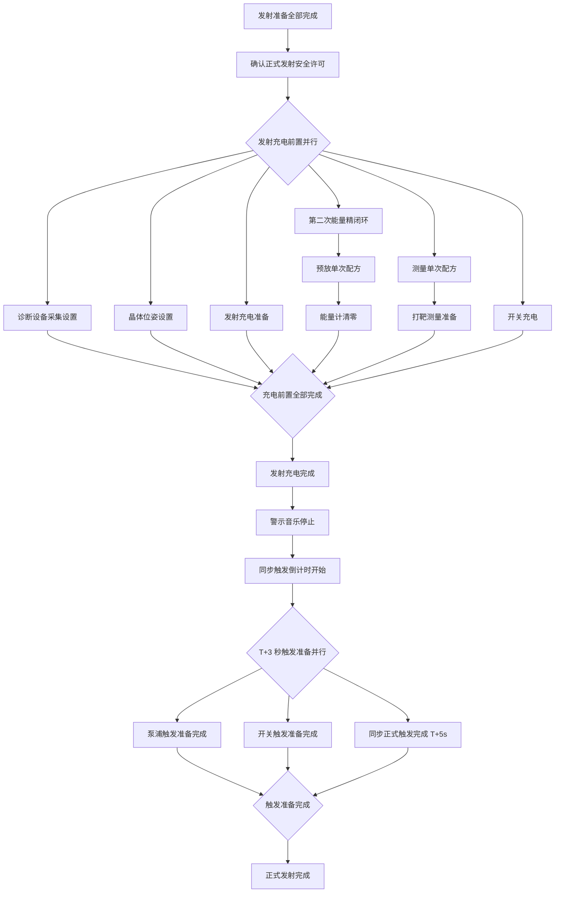

# 正式发射流程

本流程从“发射准备全部完成”开始，到“正式发射完成”结束。运行定义见 [`formal_emission.bpmn20.xml`](../../../../examples/gxlf/bpmn/formal_emission.bpmn20.xml)，完整发射任务由 [`emission_task_lifecycle.bpmn20.xml`](../../../../examples/gxlf/bpmn/emission_task_lifecycle.bpmn20.xml) 调用本阶段，随后进入[发射后处理](发射后处理流程.md)。

当前验证范围仍是已经建模的四类组件：种子源、二倍频、再生与双程放大、多程放大。再生与双程放大执行第二次能量精闭环和能量计清零；诊断设备、频率转换、泵浦、测量取样、开关驱动源和集中同步等尚未建立独立 SCXML 模型，因此由演示同步及环境 Tango 设备提供明确的条件证据。条件为 false 时流程停在对应等待节点，不会伪造命令成功。

## 流程结构

所有前置分支都必须完成后才允许发射充电。第二次精闭环必须在第一次精闭环达标的基础上执行；能量计清零必须等待预放单次配方完成。充电完成后，流程等待警示音乐停止，再等待同步系统进入倒计时。倒计时开始后，泵浦和开关触发准备必须在 T+3s 前完成，同步正式触发结果必须在 T+5s 前完成。

## 条件证据

演示条件设备支持以下条件名，控制接口为 `POST /devices/context_01/conditions`：

- `safety_permit`
- `diagnosis_acquisition_ready`
- `crystal_pose_ready`
- `charge_preparation_ready`
- `preamp_single_recipe_ready`
- `measurement_single_recipe_ready`
- `target_measurement_ready`
- `switch_charge_ready`
- `charge_complete`
- `warning_music_stopped`
- `trigger_countdown_started`
- `pump_trigger_ready`
- `switch_trigger_ready`
- `synchronized_triggered`

这些条件只表示外部系统已经反馈相应结果，不能替代真实设备的动作接口和状态机。接入真实系统时，应将每个等待节点替换为对应分系统的命令、最终结果和状态核验，并保留同样的依赖关系和 T+3/T+5 时序约束。

## 完成判据

`formalEmissionFinish` 会重新读取设备状态和外部条件，确认：所选光源仍处于出光状态；所有再生与双程放大组件处于 `wakeup/energyMeterCleared`；所有多程放大系统仍处于 `collimated/collimationReady`；所有正式发射条件证据均为真；设备没有活动命令。任一条件失效，流程失败。
