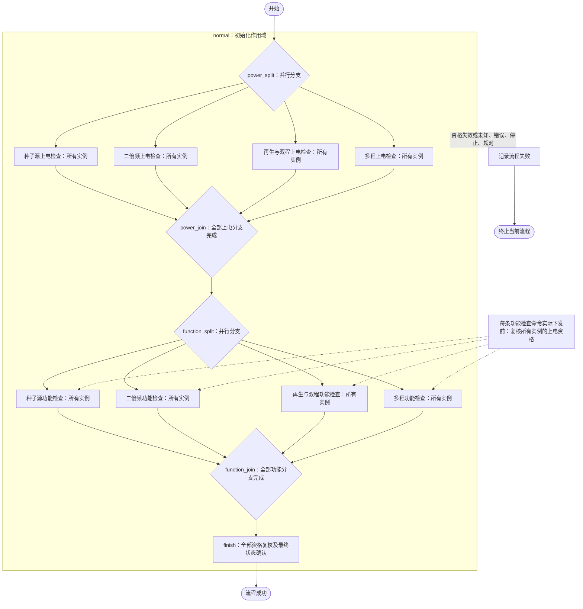
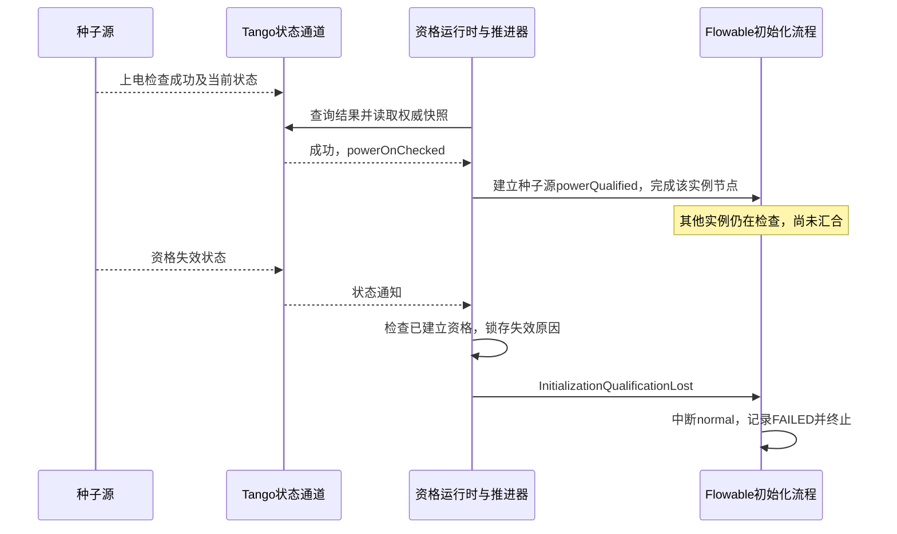

# 四类组件初始化 BPMN 解读

本文解读当前的 [component_initialization.bpmn20.xml](../../../../examples/gxlf/bpmn/component_initialization.bpmn20.xml)，对应[集中管控系统控制流程业务说明](集中管控系统控制流程业务说明.md)第 3.1 节。解释同时依据 Flowable 扩展实现，区分模型声明与运行时实际执行的行为。

这个流程负责在参数下发之前确认：**所有参与组件均已通过上电检查、功能检查，而且先通过的实例在等待期间没有失去已建立的资格。** 上电检查只确认设备是否已上电，不负责给设备上电。

## 1. 流程全貌

流程 ID 为 `component_initialization`，名称为“四类组件初始化”。正常业务都放在 `normal` 子流程中，错误、停止、资格失效和整体超时通过附着在它上面的边界事件统一退出。

下图是逻辑示意；虚线说明运行时执行点，资格复核没有被增加为独立的 BPMN 网关。



这里有两层并行：四类组件之间并行，每类组件内部的多个实例也并行。BPMN 并行表示多个执行分支可同时处于等待中，不意味着网络命令在同一物理时刻发出。

`power_join` 等待四个上电检查分支完成；每个分支又必须等自己的全部实例完成。它只汇合流程执行令牌，不会主动读取设备状态。真正的“此刻仍有资格”的复核由后续任务的 `ctl:require` 执行。

## 2. 组件、实例和检查结果

模型声明如下四类参与者，数量由运行时集合决定，没有在 XML 中写死为 1、10 或 60。

| 组件 | 实例集合变量 | 上电检查成功时的目标叶状态 | 功能检查成功时的目标叶状态 |
|---|---|---|---|
| 光纤种子源 `seed` | `seedTargets` | `powerOnChecked` | `qualified` |
| 二倍频宽带激光注入 `shg` | `shgTargets` | `powerOnOk` | `functionReady` |
| 再生与双程放大 `preamp` | `preampTargets` | `powerOnOk` | `functionReady` |
| 多程放大 `multipass` | `multipassTargets` | `powerOnOk` | `functionReady` |

上电检查的动作名统一为 `power_on_check`，功能检查为 `function_check`。例如，种子源上电检查节点 `seed_power_wait` 中的多实例声明是：

```xml
<bpmn:multiInstanceLoopCharacteristics
    isSequential="false"
    flowable:collection="${seedTargets}"
    flowable:elementVariable="target" />
```

集合中的每个元素都是包含 `id`、`component` 的目标对象，例如 `{"id":"seed_01","component":"seed"}`。每个执行实例通过局部变量 `target` 绑定自己的设备，并分别关联命令、结果和资格。

`allComponents` 是资格要求覆盖的实例集合，应包含这四类分支中全部参与实例。默认生成时排除 `context` 条件设备；工作台允许显式绑定集合，配置时需要保持两者一致。遗漏在执行分支之外、却列在 `allComponents` 中的实例无法建立资格，会阻止后续放行。

## 3. 一个检查节点实际做什么

节点在 XML 中是 `serviceTask`，但项目将带有 `componentCommand=true` 标记的任务解析为可等待外部结果的自定义活动。因此，节点名中的 `_wait` 并不意味着它是一个普通 `receiveTask`。

以种子源上电检查为例，其关键声明可以整理为：

```xml
<bpmn:serviceTask id="seed_power_wait"
                  flowable:delegateExpression="${componentCommand}">
  <bpmn:extensionElements>
    <flowable:field name="action"
                    stringValue="{&quot;seed&quot;:&quot;power_on_check&quot;}" />
    <flowable:field name="expectedState"
                    stringValue="{&quot;seed&quot;:&quot;powerOnChecked&quot;}" />
    <flowable:field name="componentCommand" stringValue="true" />
    <ctl:establish qualificationRef="powerQualified" on="verifiedSuccess" />
  </bpmn:extensionElements>
  <bpmn:multiInstanceLoopCharacteristics isSequential="false"
      flowable:collection="${seedTargets}" flowable:elementVariable="target" />
</bpmn:serviceTask>
```

执行过程是：

1. Flowable 进入节点，记录目标、动作、期望状态和稳定的 `commandId`，保留等待中的执行实例。
2. `WorkflowService` 推进器通过 Tango bridge 下发命令。若有放行约束，先执行资格复核。
3. 设备受理后继续执行，控制端结合事件通知和结果查询等待最终结果。`accepted` 只表示受理，不代表成功。
4. 收到终态结果后，核对命令 ID、动作名及 `status=succeeded`，直接读取设备当前状态，确认目标叶状态已达到且没有活动命令，并执行场景校验。
5. 校验成功后建立该设备实例的资格，再离开节点；失败则进入失败处理。

`on="verifiedSuccess"` 指的是第 4 步完成后的成功。它不是 Tango 发来的事件名，也不是设备新增的业务状态。

## 4. 资格如何在模型里表达

### 4.1 资格的作用域和生命周期

`normal` 的扩展声明包括：

```xml
<flowable:executionListener event="start"
    expression="${qualifications.open(execution)}" />
<flowable:executionListener event="end"
    expression="${qualifications.close(execution)}" />
<ctl:qualificationPolicy
    unknown="violation"
    onViolation="interrupt"
    message="InitializationQualificationLost"
    evidenceMaxAgeMs="2000" />
```

进入子流程时，运行时登记资格定义和目标集合。各实例陆续通过检查后才获得资格；尚未执行完成的实例没有资格，但单纯“尚未建立”不会在上电阶段立即终止流程。要求全部资格的节点才会检查是否缺少任何实例的资格。

一旦建立资格，就持续监测到 `normal` 退出。已建立的资格变得无效或未知时，运行时记录并锁存违反约束的原因，向对应作用域发送 `InitializationQualificationLost`，触发中断边界事件。随后设备恢复正常也不会让这次已判定失败的初始化自动继续。

`evidenceMaxAgeMs="2000"` 是资格证据的有效时间配置。当前推进器默认每轮结束后间隔 200 ms 再执行，常规检查在距上次权威读取达到有效期的一半时补读；下发前及完成前强制读取，并检查这一轮中较早读取的证据是否已过期。它不是“资格只能保持两秒”，也不是保证两秒内停机的实时期限。

### 4.2 上电资格与功能资格

| 资格 | 何时建立 | 当前状态接受条件 | 保持到何时 |
|---|---|---|---|
| `powerQualified` | 对应实例的上电检查核验成功 | 种子源叶状态为 `powerOnChecked`，其他三类为 `powerOnOk`；或者外层状态为 `ready` | 初始化作用域退出 |
| `functionQualified` | 对应实例的功能检查核验成功 | 种子源叶状态为 `qualified`，其他三类为 `functionReady` | 初始化作用域退出 |

例如种子源的上电资格谓词是：

```xml
<ctl:qualification id="powerQualified" targets="allComponents">
  <ctl:accept component="seed" states="powerOnChecked" outerStates="ready" />
  <!-- 其他三类组件的 accept 见原模型 -->
</ctl:qualification>
```

`states` 对应快照的 `state_id`，`outerStates` 对应 `outer_state`；两者是“或”关系。功能检查成功会使种子源从 `notReady/powerOnChecked` 进入 `ready/qualified`，允许外层 `ready` 可以让已经建立的上电资格继续有效。

这不表示“看到设备 ready 就自动发放资格”。资格建立仍要求本次运行中的检查命令核验成功。**设备当前业务状态、某次命令的执行结果、本次流程的放行资格，是三个分别记录又相互约束的信息。**

`expectedState` 用于核验某次命令完成时的目标；`ctl:accept` 用于此后持续判断已建立资格。前者在上电检查时要求 `powerOnChecked`，后者允许正常推进到 `ready`，用途不同。

### 4.3 功能检查下发前复核什么

四类功能检查任务都声明：

```xml
<ctl:require qualificationRef="powerQualified"
             targets="allComponents" quantifier="all" at="dispatch" />
<ctl:establish qualificationRef="functionQualified" on="verifiedSuccess" />
```

含义是：每条功能检查命令真正发送前，要求 `allComponents` 中每个实例都已经建立上电资格，并且已有资格仍满足当前证据检查。检查范围覆盖全部参与组件，而不只检查这条命令的目标。

因此，即使 `power_join` 已经汇合，后续尚未发出的功能检查命令也可能被拦住。汇合证明“检查节点都完成过”，下发复核进一步确认“现在仍然可以继续”。已建立的功能资格同样继续被监测，防止功能检查先通过的实例在最终汇合之前失效。

### 4.4 最后为什么还要有 finish

`function_join` 之后的 `finish` 先执行开始监听器 `${qualifications.check(execution)}`，依据两条 `at="completion"` 声明复核全体实例的上电资格和功能资格。这里的 `completion` 表示初始化完成关口；具体执行位置是 `finish` 的开始监听器。

随后执行 `${tango.initializationFinish(execution)}`，再次读取四类组件，要求：

- 每类目标集合非空；
- 所有种子源处于 `ready/qualified`；
- 其他三类全部处于 `ready/functionReady`；
- 所有目标都没有活动命令。

全部通过后写入 `outcome=SUCCEEDED`，经 `scope_end` 退出子流程，再到 `success`。因此，当前实现仍保留了 Java 中的最终状态核验，完成判据还没有全部迁移为 `ctl` 声明。

## 5. 先通过的组件在等待时失效，会发生什么

以种子源先通过、其他组件还在执行上电检查为例：



已接收到、版本有效的失效通知会参与检查，设备随后恢复的通知不能简单覆盖这个失败事实。若未收到通知，常规权威补读以及下发前、完成前的强制读取还能发现当前资格失效。当前实现没有设备端资格历史查询，不能仅凭一次正常快照证明所有未收到的瞬时变化都不存在。

状态通道断开时，推进器仍检查已建立资格，不会因为 `gateway.connected()` 为 false 就跳过这项检查。短暂断连也会通过内部 `connection_lost` 通知保留证据。

| 证据情况 | 当前处理 |
|---|---|
| 同一设备实例的旧版本状态通知 | 忽略，避免旧通知使状态倒退 |
| 直接读取到更低的状态版本 | 判定证据异常，资格失效 |
| `source_id` 改变，即使状态名称相同 | 视为设备运行时实例更换或重启，原资格失效 |
| 权威读取失败、设备断连、事件证据溢出 | 无法确认资格，按违反约束处理 |
| 控制端重建资格运行时 | 从持久化记录恢复并复核；要求设备实例未变、恢复时状态版本与保存记录一致 |

恢复时版本发生变化，即使当前状态又满足条件，也按证据不连续处理。这是当前采用的保守恢复策略。

## 6. 异常、超时与结束结果

`normal` 上有四个中断型边界事件，均设置 `cancelActivity="true"`：

| 边界事件 ID | 触发条件 | 后续路径 |
|---|---|---|
| `error_boundary` | BPMN 错误 `DEVICE_ERROR` | `failure → failed_end` |
| `stop_boundary` | 消息 `StopWorkflow` | `failure → failed_end` |
| `qualification_boundary` | 消息 `InitializationQualificationLost` | `failure → failed_end` |
| `workflow_timeout` | `${workflowTimeout}` 到期 | `failure → failed_end` |

八个检查活动还分别带有 `${commandTimeout}` 定时边界。到期后进入 `raise_timeout`，抛出 `DEVICE_ERROR`，再由 `normal` 的错误边界统一处理。计时边界附着在 BPMN 检查活动上，不是设备内部实现的命令超时。

XML 使用流程变量给出超时长度；当前默认值为 `commandTimeout=PT15M`、`workflowTimeout=PT45M`，即 15 分钟和 45 分钟，实际使用值由启动配置决定。它们与资格证据的 2000 ms 有效期是不同参数。

`failure` 调用 `${tango.failed(execution)}` 写入 `outcome=FAILED`，保留或补充 `failureReason`。`failed_end` 是终止结束事件，结束当前流程实例内的剩余执行。持续监测和下发保护发现失效时使用资格消息边界；完成校验等同步执行路径也可能抛出 `DEVICE_ERROR`。运行推进器对触发回调异常还保留停止消息兜底，所以失败不一定都经过资格消息边界。

本模型没有自动重试、恢复执行或设备复位分支，也没有直接向所有设备下发停止命令。取消 Flowable 活动能停止后续编排，已经由设备受理的动作仍需设备停止协议或本地联锁处理。

在[完整发射任务流程](../../../../examples/gxlf/bpmn/emission_task_lifecycle.bpmn20.xml)中，调用方将本流程的 `outcome` 接收为 `initializationOutcome`，只有其值为 `SUCCEEDED` 才继续参数下发。因此不能只凭“子流程已经结束”判断初始化成功。

## 7. BPMN、扩展代码和 Tango 各自负责什么

| 层次 | 在这个流程中的职责 |
|---|---|
| 标准 BPMN | 顺序、两级并行、多实例、作用域、错误/消息/定时边界、成功及失败路径 |
| Flowable 扩展 | 表达式、实例集合、执行监听器和可等待外部结果的组件命令活动 |
| 项目 `ctl` 扩展 | 声明资格定义、状态谓词、建立时机、全部实例要求、失效策略及证据有效期 |
| Java 运行时 | 解释扩展、关联命令结果、持久化和复核资格、发送边界消息、执行最终场景核验 |
| Tango 与设备 SCXML | 执行设备动作，报告当前状态、命令结果及实例/状态版本证据 |
| BPMN DI | 图形坐标、节点大小和连线布局，不参与资格或设备逻辑判断 |

`ctl` 的命名空间是 `https://cdi8.cn/control/qualification/v1`，属于本项目定义的执行语义。通用 BPMN 编辑器可以保存这些扩展，但要运行它们，需要本项目的解析器、监听器与资格运行时；Flowable 原生并不会自动理解 `ctl:require`。

关键代码入口如下：

- [QualificationModel.java](../../../../server/src/main/java/cn/cdi8/workbench/qualification/QualificationModel.java)：解析与校验资格声明，包括引用、监听器和中断消息边界。
- [QualificationRuntime.java](../../../../server/src/main/java/cn/cdi8/workbench/qualification/QualificationRuntime.java)：建立、持续检查、下发保护、最终复核和失效中断。
- [ComponentCommandBpmnParseHandler.java](../../../../server/src/main/java/cn/cdi8/workbench/integration/flowable/ComponentCommandBpmnParseHandler.java)：将组件命令标记解析为可等待活动。
- [ComponentCommandTasks.java](../../../../server/src/main/java/cn/cdi8/workbench/run/ComponentCommandTasks.java)：登记命令、核验成功并建立实例资格。
- [WorkflowService.java](../../../../server/src/main/java/cn/cdi8/workbench/run/WorkflowService.java)：消费状态通知，周期推进流程，在实际命令发送处执行资格保护。
- [TangoGateway.java](../../../../server/src/main/java/cn/cdi8/workbench/integration/tango/TangoGateway.java)：快照读取、命令交互、旧通知过滤与断连通知。
- [GxlfCompletionChecks.java](../../../../server/src/main/java/cn/cdi8/workbench/scenarios/gxlf/GxlfCompletionChecks.java)：`initializationFinish` 的最终状态核验。

活动资格存放在 Flowable 变量 `qualificationRegistry`，按作用域和实例记录命令来源、设备实例标识、状态版本和观测位置。作用域退出时，其记录转存为 `qualificationAudit`；该变量是作用域记录快照，不是逐条事件的完整审计日志。运行查询还返回 `failureReason`，用于解释本次未放行的原因。

资格有效期到初始化作用域退出为止。它不会自动作为跨流程、长期有效的设备证书传递到参数下发或正式发射；后续阶段需要自己的入口检查和持续约束。

## 8. 当前验证与适用边界

[WorkflowIntegrationTest.java](../../../../server/src/test/java/cn/cdi8/workbench/WorkflowIntegrationTest.java)覆盖等待期间失效、短暂失效后恢复、断连、无效读取证据、旧事件、正常进入就绪、设备实例更换、缺失实例资格、持久化记录恢复和最终复核等场景。

[JavaWorkbenchE2eIT.java](../../../../server/src/test/java/cn/cdi8/workbench/JavaWorkbenchE2eIT.java)已通过实际 Java bridge、JTango 设备和 Flowable 的完整 GXLF 双光源流程验证。资格恢复的专项验证目前采用重建运行时对象并读取持久化记录，尚未单独验证“初始化期间强杀工作台进程，再启动恢复”的完整跨进程场景。

网络事件与流程推进存在延迟，多个设备的权威读取也不是原子快照。此实现可以依据已获取的证据阻止后续放行，但不能消除读取状态之后、设备受理命令之前的状态变化窗口。设备仍需要在受理动作时检查自身条件，并承担本地实时联锁职责。
