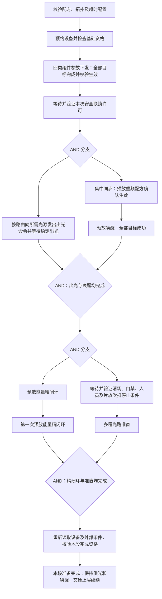

# 种子源至多程放大前期准备流程

本定义覆盖“参数下发 → 种子源/二倍频出光及预放唤醒 → 第一次能量闭环、光路准直 → 本段准备完成”。依据为[业务说明](集中管控系统控制流程业务说明.md)第 3、4、6.1、6.2、6.4–6.7、6.14 节，以及当前四类组件的 SCXML 模型。

本文统一记录完整业务设计及尚待接入的约束，主流程见第 3 节。BPMN 统一维护[运行定义](../../src/main/resources/processes/optical_frontend_preparation.bpmn20.xml)，流程图在总控页面选择“种子源至多程放大前期准备”查看，启动方式见[项目说明](../../README.md)。运行版暂按设备集合执行，不包含束线拓扑、完整配方参数和全部发次证据；同步、安全、环境条件由明确标识的演示 Tango 设备提供。本文中的节点标识和完整业务要求不表示运行版已全部实现。

运行实现的边界：当前停止流程只中断编排，组件尚无取消在途动作的接口；设备级停光与复位由组件端处理。详细业务定义中的取消/物理处置策略仍需后续接入。

## 1. 范围和完成边界

本段直接控制四类对象，数量沿用业务说明的全规模口径；实例集合随本次配方冻结。

| 对象 | 全规模数量 | 本段动作 | 结束时设备资格 |
|---|---:|---|---|
| 光纤种子源 `seed` | 1 | 参数下发；被配方选中时出光 | 被选中时保持稳定出光 |
| 二倍频注入 `shg` | 1 | 参数下发；被配方选中时出光 | 被选中时保持稳定出光 |
| 再生与双程放大 `preamp` | 10 | 参数下发、唤醒、粗闭环、第一次精闭环 | 唤醒 / 精闭环达标 |
| 多程放大 `multipass` | 60 | 参数下发、光路准直 | 准直 / 光路准直达标 |

集中同步的“预放重频配方”是本段所需的外部控制动作；安全联锁、清场/门禁/人员、真空和吹扫停止由相应系统提供有效确认。本模型不把这些条件默认为成功，也不在四类组件内部添加伪状态。

本段结束只产生 `frontend_prepared` 结果，**不等于整个“发射准备全部完成”**。靶瞄、测量、诊断和泵浦等其他准备链路仍须在上层流程汇合。光路准直完成后，上层可与模拟靶定位汇合进入光束引导；无需等待本段精闭环链路结束才处理该准直结果。

以下动作位于本段之后：光束引导、多程“进入打靶状态”、第二次精闭环、单次配方、能量计清零、正式触发、采集、待机和关机。上电检查与功能检查属于本段启动前的设备准备，不能把旧演示流程的开关机周期直接串入本段。

## 2. 与运行 BPMN 的关系

当前运行版由 `TangoTasks` 登记/核验命令，`WorkflowService` 按 Tango 事件查询结果并唤醒 Flowable；每 5 秒补查处理漏事件及恢复。设备字段使用 SCXML 的 `model/outer_state/state_id/active_command_id` 和任务结果。页面直接渲染引擎部署的 BPMN 与活动历史。

本段保留“命令受理 → 等待最终结果 → 核验当前资格”的任务生命周期；多实例全部成功才推进，失败和超时中断准备流程。本段成功表示准备资格建立，出光和唤醒持续保持。完整业务要求还包括当前发次的路由、设备预约、证据有效期及物理停止策略，分别在下文记录，后续实现应同步更新运行 BPMN。

## 3. 主流程和并行关系



关键执行约定：

1. 同步预放重频切换完成后即可唤醒预放，不必等待光源出光完成。
2. 出光全部完成与预放唤醒全部完成在 AND 网关汇合，之后才允许粗闭环或准直。
3. 粗闭环 → 第一次精闭环是同一预放实例上的顺序依赖。当前定义先等全部预放粗闭环完成，再启动全部实例的第一次精闭环，作为整组屏障；没有自行引入按实例流水执行。
4. 多程光路准直依赖出光、预放唤醒、同步预放重频、安全及吹扫条件，**不依赖粗闭环或第一次精闭环完成**，因此与闭环链路并行。
5. 本定义对所选预放集合和多程集合采用整组屏障。按束线/束组局部放行属于后续优化，需要先确认物理映射和失败影响范围。
6. 每个 AND 网关的每条入边只产生一份整组完成 token。单设备反馈先在多实例子流程内汇总，不能将 60 份反馈直接送到只有两条入边的网关。

## 4. 配方、路由与启动条件

启动输入必须冻结以下内容，关联到同一 `run_id/shot_id/recipe_version`：

| 输入 | 定义及校验 |
|---|---|
| `parameterTargets` | 本段已预约的四类设备实例；全规模为 1+1+10+60=72 个；开发缩比须显式配置 |
| `beamRoutes` | 每条参与束线的光源选择、预放实例、多程实例和同步通道映射；每条束线只选择一个光源 |
| `shgCapableBeamIds` | 允许选择二倍频光的固定 8 条束线清单；具体编号由配置提供 |
| `emissionTargets` | 由路由推导，按物理光源设备去重，绑定 `seed_source_emit` 或 `frequency_doubled_emit`；非空 |
| `preampTargets` / `multipassTargets` | 由拓扑推导并去重的参与设备集合；非空，且属于已预约及已配置目标 |
| `syncTargets` | 参与束线对应的集中同步目标；全规模按业务说明为 60，不能因预放只有 10 台而改成 10 |
| `targetEnergy` | 按预放实例/受控通道提供的目标能量及单位，供粗闭环和精闭环调用；字段和单位尚待设备契约确认 |
| `timeouts` / `evidencePolicy` | 各节点截止时间、外部等待时限及证据有效期；均须显式配置 |

本模型没有指定哪 8 条束线可用二倍频，也没有推断“每个预放必然固定带 6 个多程”的现场映射。映射缺失、重复冲突、覆盖不全、集合为空或目标未预约时，在首条命令前拒绝启动。

启动预检要求二倍频、预放和多程处于 `ready/functionReady` 或 `ready/parameterOk`，种子源处于 `ready/qualified` 或 `ready/configured`，服务可用且无冲突活动任务。`notReady/powerOnOk`、`notReady/powerOnChecked` 尚需先完成功能检查。预约建立后应持续监控资格，直至上层实验接管。

“种子源/二倍频”不是整个实验二选一的 XOR，也不是永远强制两台都执行的 AND。混合路由可以同时需要两类光源；纯种子源路由只等待种子源出光。若二倍频的实际供光还依赖种子源，须把这种物理依赖补入路由及光源子流程；当前业务说明和 SCXML 不足以确定该顺序，不能照搬旧演示的固定“种子源 → 二倍频”。

即使某个源不承担本次出光，业务说明第 6.4 节要求的两类光源服务健康检查仍保留；参数下发覆盖本段预约清单。本次不用的源不会产生出光等待 token。

启动时所有目标不得有活动任务，并须完成基础资格检查：种子源在 `ready/qualified` 或 `ready/configured`，其他组件在 `ready/functionReady` 或 `ready/parameterOk`。这是本段接受的启动状态集合，不表示其他状态下设备自身一定禁止参数下发。种子源的 `notReady/powerOnChecked` 与其他组件的 `notReady/powerOnOk` 都仅代表上电检查通过，必须先完成功能检查。

## 5. 动作节点及状态契约

所有动作必须验证命令编号、设备实例、动作、所属发次和配方，再检查任务 `status=succeeded`、无活动命令和设备资格。表中设备 ID 均来自 SCXML，中文只用于显示。

| BPMN 节点 | 目标 / 动作 | 发送前条件 | 本次最终反馈 / 后状态 | 业务参考时长 |
|---|---|---|---|---|
| `configure_components` | `parameterTargets`，`parameter_dispatch` | 配方加载、总控/目标服务正常、预约有效、基础资格通过 | 所有目标本次参数命令成功；种子源为 `ready/configured`，其他组件为 `ready/parameterOk`；`configuration.status=valid` | 2s |
| `sync_preamp_repeat` | `syncTargets`，同步预放重频配方 | 参数全部生效、同步服务及安全许可有效 | 所有目标确认本发次预放重频配方生效；不能只核对指令已收到 | 2s |
| `emit_sources` | `emissionTargets`，按模型选择出光动作 | 本次配置生效、光源服务正常、安全许可有效、路由有效 | 所有被选中光源本次命令成功，`outer_state=emitting`；种子源和二倍频初次进入 `stableEmission` | 10min |
| `wake_preamp` | `preampTargets`，`preamp_wakeup` | 本次配置生效、同步预放重频正常、服务及安全许可有效 | 每台本次唤醒成功，`wakeup/wakeupReady` | 8min |
| `coarse_loop` | `preampTargets`，`coarse_loop` | 出光/唤醒 AND 完成；重读路由光源、唤醒、同步模式、服务、安全及目标能量 | 每台本次粗闭环成功，`wakeup/coarseLoopOk` | 2min |
| `first_fine_loop` | `preampTargets`，`fine_loop` | 全部粗闭环完成且资格持续有效；供光、同步模式、服务、安全有效 | 每台本次第一次精闭环成功，`wakeup/fineLoopOk` | 2min |
| `collimate_multipass` | `multipassTargets`，`optical_collimation` | 出光/唤醒 AND 完成；本次配置生效、同步预放重频、安全、真空及服务有效；清场/门禁/人员和片放吹扫停止已确认 | 每台本次准直成功，`collimated/collimationReady` | 10min |

源业务文档的“接收状态 1：收到”只代表命令接受，不能直接作为上述完成条件。当前模拟器所有动作统一使用 `Execute → Complete/Simulate` 两段；同步接口如果能一次返回经过验证的最终生效证据，可直接进入校验，否则仍须等待最终确认。

### 5.1 每个动作的内部 BPMN 结构

```text
整组预检
  → 并行多实例（按设备去重后的目标集合）
      → 逐实例重新检查本地及跨系统守卫
      → 事务内保存 command_id 和等待关联，提交后发送命令
      → 等待本实例最终结果
      → 校验关联、本次结果及后状态
  → 所有实例成功，整组结束
```

多实例不设置提前完成条件；任一拒绝、失败、`interrupted`、反馈不匹配或状态不满足，抛出 `PREPARATION_FAILED`，中断整个准备作用域。外层整组预检不能替代逐实例发送前的再次检查；预检与分发之间可能发生故障。整组预检也不承诺物理设备全部同时接受或全部不执行。

### 5.2 当前 SCXML 上下文的使用限制

`ComponentRuntime._completion_context()` 在设备离开 `ready` 后会把 `configuration` 清为 `unknown`。因此源进入 `emitting`、预放进入 `wakeup`、多程进入 `collimated` 后，不能继续要求快照里的 `configuration.status=valid`。

总控须保留本次参数命令的成功证据、配方版本与设备映射，并结合当前设备资格及期间的失效事件判定。当前快照已有持久化事件序号 `state_revision`，可区分状态变化顺序；完整的发次标识、配方关联及证据新鲜度管理仍需补足，不能从一次历史成功自行推断当前有效。

## 6. 外部条件与持续守卫

| 条件 | 来源及语义 | 使用点 |
|---|---|---|
| `safety_permit` | 安全服务针对本发次的有效许可，涵盖已配置的门禁、人员、真空等条件；未知/过期不放行 | 参数生效后等待；同步、出光、唤醒、闭环、准直和段末重新检查 |
| `preamp_repeat_ready` | 集中同步确认所有本次所需通道处于预放重频模式 | 唤醒及后续所有准备动作 |
| `collimation_environment_ready` | 清场及必要门禁完成、人员计数归零、片放吹扫停止，并满足真空和服务条件 | 光路准直发送前 |
| `source_route_ready` | 每条参与束线选定的源当前稳定供光，路由及版本匹配 | 粗闭环、精闭环、准直及段末 |
| `preamp_awake` | 参与预放保持 `outer_state=wakeup`，子状态为 `wakeupReady/coarseLoopOk/fineLoopOk` 之一；本次唤醒证据有效 | 粗闭环、精闭环和准直 |
| `service_health` | 总控、参与设备以及业务规定的光源/同步服务可用 | 每次发送前、等待期间和段末 |

准直检查 `preamp_awake` 时，允许预放正在执行本次粗闭环或精闭环；它们保持唤醒资格。不能要求预放必须精确处于 `wakeupReady` 或全程无活动任务，否则会错误地串行化两条并行链。无活动任务的要求适用于当前动作的目标设备，以及段末统一核验。

外部确认必须记录来源、`run_id/shot_id`、适用目标、配方/模式版本、采样时间和有效期。早到的确认先持久化，再检查等待条件，避免“事件先到、receiveTask 后建”造成永久等待；相同事件去重。`wait_safety_permit` 与 `wait_collimation_environment` 只消费经适配层核验的条件证据，不向四类组件发送伪造的确认动作。

清场、关门和停止吹扫由外部流程负责，本段等待它们的事实；与上层集成时必须确保外部流程能独立推进，不能反过来等待本段完成。业务说明中的风淋门是否必需仍待确认；通过显式条件策略确定，未决时保持阻塞，不能静默当作已锁定。

AND 网关记录的是“前驱曾经完成”，不是“资格现在仍有效”。各节点在发送前重读，在等待期间监测，在段末统一重验。出光停止、唤醒丢失、配方/路由变化、同步退出重频、联锁触发或证据过期时，禁止继续放行；需要由适配层通知并中断当前准备作用域。失效监测从预约成功持续到上层接管，不能因某个分支已经完成而停止。

## 7. 时限、失败与联锁

业务参考时长是工艺估计，不直接作为 SLA。完整业务要求为参数下发、出光、同步重频、唤醒、粗闭环、第一次精闭环、准直及外部条件等待分别配置截止时间，启动前要求配置完整；计时起点为进入该动作子流程，包括预检、排队、发送、等待和校验。运行版暂使用统一的动作和流程超时，细分时限仍需接入。同步/参数的 2s、出光和准直的 10min 等都不能被擅自换成演示用 10s。

正常工况下，参数下发后并行的“出光 10min”与“同步 2s + 唤醒 8min”约需 10min；其后闭环链约 4min、准直约 10min。外部条件已满足时本段参考关键路径约 **20min 2s**，不含预约、条件等待和通信校验开销。这不是整个发射准备阶段的总时长。

失败定义及收敛路径：

1. 动作拒绝、无权限、最终失败、`interrupted`、反馈非法、资格失效或超时，均中断 `preparation_scope`，使所有并行等待失效；旧反馈只记录，不能推进后续节点。
2. `Interlock` 为按运行编号关联的中断消息；外部持续资格失效经适配层转换为同一停止路径。接到事件立即撤销本段放行并锁存失败原因。
3. 进入统一的“记录失败 → 请求停止 → 等待真实停止确认 → 核验”路径。停止请求不等于物理关光或安全到位；具体关光、复位、停止顺序及超时由独立停止策略提供。本定义不套用旧演示的固定四实例串行 `abort_reset`。
4. 新模拟器没有 `Cancel`；有活动任务时直接发 `abort_reset` 也会被拒绝。停止适配必须先解决活动任务中断并得到设备确认，再按允许状态执行复位。`ReportEvent` 是事实确认接口，不能把它当作实际物理停止指令。
5. 停止超时、拒绝或核验失败进入人工处置；人工核验完成后仍为本段失败。停机未确认前不释放资源、不自动重启。不定义自动重试能量闭环、出光或准直。
6. 成功结束不自动关光、不待机、不释放给其他实验。本段的预约和持续监测须由同一上层实验接管；接管失败必须撤销准备资格并停止。交接协议尚未实现。

## 8. 本段完成判据

段末 `verify_frontend_ready` 一次性校验以下集合，任一未知、失效或不匹配均失败：

- 本次参与清单、路由、配方、设备预约和目标能量版本一致；配置成功记录完整，期间无未处理失效。
- 所有所需源的本次出光命令成功、当前 `outer_state=emitting`，无活动任务，束线路由确认有效。未选中源不要求出光。
- 每个参与预放有本次唤醒、粗闭环、第一次精闭环成功证据，当前 `wakeup/fineLoopOk`，无活动任务。
- 每个参与多程有本次准直成功证据，当前 `collimated/collimationReady`，无活动任务。
- 同步预放重频、所有服务、安全许可、准直环境和持续供光仍有效。

输出包括 `frontend_prepared=true`、发次及配方版本、各节点/设备命令结果引用、当前资格证据、参与清单、持续监测与资源归属。`first_fine_loop` 与 `collimate_multipass` 的分支完成事实可分别交给上层作 AND 汇合输入，不能用 `frontend_prepared` 代替其他系统的准备结果。

## 9. 接入前仍需明确的契约

| 项目 | 当前处理 |
|---|---|
| 10 个预放、60 个多程及同步通道的实际拓扑 | 必填配置；不推断映射 |
| 固定 8 条二倍频束线及二倍频对种子源的物理依赖 | 必须确认并写入路由策略；不固化旧演示顺序 |
| 同步“收到”与“模式已生效”的判据、目标能量字段/单位 | 由真实设备契约补足 |
| 外部证据有效期、节点超时、风淋门策略 | 必填策略；不补造数值或默认成功 |
| Tango 活动任务停止及物理安全确认 | 新增适配契约；当前模拟器无取消命令 |
| 发次关联、状态版本与成功后的监测/预约交接 | 由总控和适配层实现 |

这些是完整业务接入项，不改变已经明确的并行依赖：出光与唤醒先汇合，闭环链与准直再并行。当前 Java 服务已能运行四组件的简化联合准备，尚未覆盖本定义的全部生产契约。运行版暂使用统一动作超时和流程超时，演示条件不具备发次证据、有效期或物理停止能力。

## 10. 定义校验记录

2026-10-15 对原业务设计稿完成以下校验。该独立 BPMN 设计稿已移除，历史版本可从 Git 查阅；以下为历史校验记录：

- 使用项目依赖的 Flowable 7.1.0 验证 BPMN 2.0 XML Schema 并解析模型；通过。
- 检查标识引用、同作用域连线、无提前完成条件的并行多实例，以及全部 17 个作用域的图形和连线布局；通过。
- 将整组动作抽象为原子活动，遍历正常路径的 24 个可达 token 标记；无死锁，确认唤醒可先于出光完成、准直可先于精闭环完成、精闭环可先于准直环境确认完成。
- 使用内存 SQLite 和当前 SCXML 运行时，分别校验 72 台设备的纯种子源及种子源/二倍频混合选择；参数、出光、唤醒、粗闭环、第一次精闭环和准直的动作/后状态与模型一致。另确认预放粗闭环活动期间，多程本地准直转换可成立。

以上为原业务设计稿的定义校验。后续运行版另已验证：19 项真实 Flowable 集成测试、13 项 Python 测试（含真实 Tango 事件订阅）；纯种子源与双光源联合准备；Java 离线期间设备完成后的实际重启恢复；浏览器当前节点着色、并行多实例聚合及子流程导航。初始化另使用独立的[资格汇合网关](qualification-gateway.md)，验证部分完成等待、期间失效锁存、当前资格补读、命令关联、协调器恢复与超时。真实停止策略、完整证据有效期与物理设备接入仍需验证。
