# 种子源层级状态机（v3 上电检查与功能检查）

根据[状态梳理清单](集中管控系统与分系统状态梳理清单.md#seed)及分层状态讨论修订，本次上电检查与功能检查口径更新于 2026-10-15。权威定义见 [SCXML 1.0 模型](seed-source-state-machine.scxml)，[Mermaid 图源](diagrams/seed-source-state-machine-draft.mmd)和[完整状态图](diagrams/seed-source-state-machine-draft.svg)用于阅读和评审。

## 描述语言

采用 W3C SCXML 1.0 作为状态机的标准描述语言。SCXML 文件表达复合状态、初始子状态和事件转换；Mermaid 只承担图形展示，不能反向成为第二套状态定义。状态机执行器仍需把设备反馈映射为 SCXML 事件，并在外部保存任务、配置资格、数据资格及完整故障集合。

## 状态与任务分开建模

保留“未就绪”“就绪”“出光”“设备异常”四个外层主状态；不设动作过渡区。内层只保留会影响后续操作的局部条件，不为每个请求建立一套“等待—执行中—成功—失败”状态。

参数下发、出光、采集、关光、复位、关机、中止和故障恢复的请求、执行进度、反馈及超时，由独立任务记录保存。任务状态不能代替设备状态，也不构成第三层设备状态。设备状态在相关条件变化或取得有效反馈时转换。

| 外层主状态 | 内层子状态 | 建模含义 |
|---|---|---|
| 未就绪 | 待上电检查、上电检查通过待功能检查、功能检查未通过 | 上电检查通过仍未取得完整就绪资格；功能检查通过且确认就绪后才退出。上电检查未通过记录为任务结果，继续待上电检查。 |
| 就绪 | 业务就绪、参数配置生效 | 基础功能可用。只有当前参数确认有效、联锁满足且无冲突任务时才接受出光。启动失败若确认仍就绪且参数有效，则保持参数配置生效，允许重试。 |
| 出光 | 尚无本次采集结果、采集完成、采集失败 | 稳定供光条件持续满足，内部采集不改变父状态。采集完成不代表数据可用。 |
| 设备异常 | 异常待分类、故障锁定、通信异常、执行超时 | 业务放行阻断。恢复过程是任务，失败仍保持异常；所有阻断条件解除且复位校验通过后进入未就绪。 |

事件可以来自分系统内部或外部，事件来源与转换层级独立。外部采集请求只改变当前采集子状态或启动任务；内部稳定出光确认则可以改变外层主状态。

## 子状态细节

### 未就绪

上电检查请求发起任务，只确认所辖设备是否均已上电；通过后进入未就绪/上电检查通过待功能检查。功能检查请求及重试发起任务；检查通过且就绪确认后进入“就绪/业务就绪”。检查未通过反馈进入功能检查未通过；上电资格丢失后退回待上电检查。图中不增加上电检查中或功能检查中。

### 就绪

在业务就绪时发起参数下发任务，校验通过后进入参数配置生效。接受重配请求、配置变化或有效性失效时立即撤销旧参数资格，回到业务就绪。下发失败保持业务就绪，失败原因保存在任务结果中。

出光请求要求当前配置有效、联锁满足、状态证据可信，且没有冲突任务；任务执行期间不新增出光启动中。只有当前任务反馈稳定出光且对应当前配置时，才进入“出光/尚无本次采集结果”。启动失败且确认安全关光、仍就绪时保持原状态；不能证实设备资格时阻断并执行相应安全处置。

### 出光

采集请求建立新任务。任务完成或失败分别进入采集完成、采集失败；重采时回到尚无本次采集结果，任务记录另外标明正在执行。首次采集请求可以保持尚无本次采集结果，不必产生新的设备状态。

数据完整性、范围、采集窗口、时间戳、发次归属和有效期作为独立的数据资格记录，不再新增数据有效或数据无效子状态。只有当前结果通过数据检查才能用于后续分析；历史结果保留，新任务不能继承上一任务的数据资格。采集失败若稳定供光仍保持，不因此退出出光。

### 设备异常

按有效证据进入故障锁定、通信异常或执行超时。恢复请求仅创建任务；恢复失败保持异常，不新增异常恢复中或恢复失败状态。通信恢复也不等于恢复了就绪或出光资格。

多个故障可以并存：完整故障集合独立记录，异常子状态表示当前主导处置类型；主导类型可随故障集合变化重新选择。只有全部阻断条件解除、旧任务作废、安全复位校验通过后，才回到“未就绪/待上电检查”。异常状态并不表示物理出光已经停止。

## 关光、复位、关机与中止

这些动作由任务记录跟踪，不增加设备中间状态。请求接受后立即设置调度阻断、抢占冲突任务并执行设备动作；完成时根据反馈确认目标主状态。当前仿真器已将关机请求作为 `shutdown` 任务提供；SCXML 表达其完成事件，任务请求本身不改变设备状态。

| 动作 | 完成反馈及目标状态 |
|---|---|
| 正常关光或待机/复位 | 安全关光、资源释放且就绪资格确认后进入就绪；安全但不具备资格时进入未就绪。重新进入就绪后从业务就绪开始。 |
| 关机 | 安全下电完成后进入未就绪。原先未就绪的设备保持未就绪；原先异常的设备只有全部阻断条件解除才能退出异常，关机不自动清除故障。 |
| 异常中止 | 安全复位完成且无未清阻断故障后进入未就绪；仍有阻断故障保持或进入设备异常。 |
| 恢复 | 所有故障解除且安全复位校验通过后进入未就绪；失败保持设备异常。 |

请求到完成期间，设备状态依据实际资格更新，不能为了保持原状态而忽略资格失效。供光资格撤销、稳定监测丢失、出光期间配置失效或安全联锁撤销时，立即退出出光、进入设备异常并执行安全处置，不等待关光任务完成。就绪资格已撤销且确认安全时进入未就绪；状态未知或确认异常时进入设备异常。

安全动作失败/超时经分系统确认后进入设备异常。正常采集或参数下发失败若不损害设备资格，可以仅作为局部任务失败处理。阈值、时限及安全动作顺序仍需具体定义。

## 事件及放行规则

1. **安全事件优先。** 故障、资格失效、关机及中止请求先设置调度阻断并作废被抢占任务；多个安全事件的设备处置顺序由安全策略确定。
2. **任务互斥单独判断。** 不用“xx中”子状态表达忙碌。接受普通请求前检查当前任务、资源锁、调度阻断及相关资格；安全请求可以抢占冲突任务。
3. **反馈与当前任务、参数版本及发次关联。** 重复请求/反馈幂等处理；被抢占、已超时及旧配置对应的迟到成功不推进状态。超时恢复必须重新确认实际设备状态。
4. **数据资格独立。** 采集完成与数据可用分别判定。历史数据、故障集合、任务结果不因外层状态切换而删除。
5. **父状态出口覆盖全部子状态。** 如出光到设备异常适用于无采集结果、采集完成及采集失败。主状态重新进入使用初态，不自动恢复历史子状态。
6. **放行不是单看主状态。** 除主状态与局部条件外，还需任务/资源无冲突、未阻断、联锁与反馈有效。接受安全动作后即撤销对应调度许可；证据未知不视为满足。

## 与清单及实现的关系

种子源清单保留原 11 条编号和原表结果，另列实际子状态及反馈映射。“稳定出光正常”“复位完成”“关机正常”等是结果证据，不全部是独立叶子状态。

[仿真器](../simulator/README.md)已经按 `seed-source-hierarchical-v3` 运行，状态转换从 SCXML 加载；任务进度、配置资格、数据资格和故障集合独立保存。四类组件共享上电检查和功能检查资格语义；Mermaid 图仅用于展示，测试校验检查顺序、失败阻断和状态归属。

修改图源后，运行 `mmdc -i docs/diagrams/seed-source-state-machine-draft.mmd -o docs/diagrams/seed-source-state-machine-draft.svg -t neutral -b transparent` 更新 SVG（需安装 Mermaid CLI）。四类组件的 Mermaid 源文件由 `scripts/render_component_diagrams.py` 从 SCXML 生成；SVG 可用 Mermaid CLI 渲染。
